# CineFlow

### Where Every Movie Has a Story.

CineFlow is a movie-focused web application developed using Python and Flask. It provides a visually engaging platform for exploring movies, viewing movie details and trailers, and discovering content through a user-friendly interface.

The project combines backend development with frontend technologies to create an organized and interactive movie website.

---

## Application Preview

### Homepage

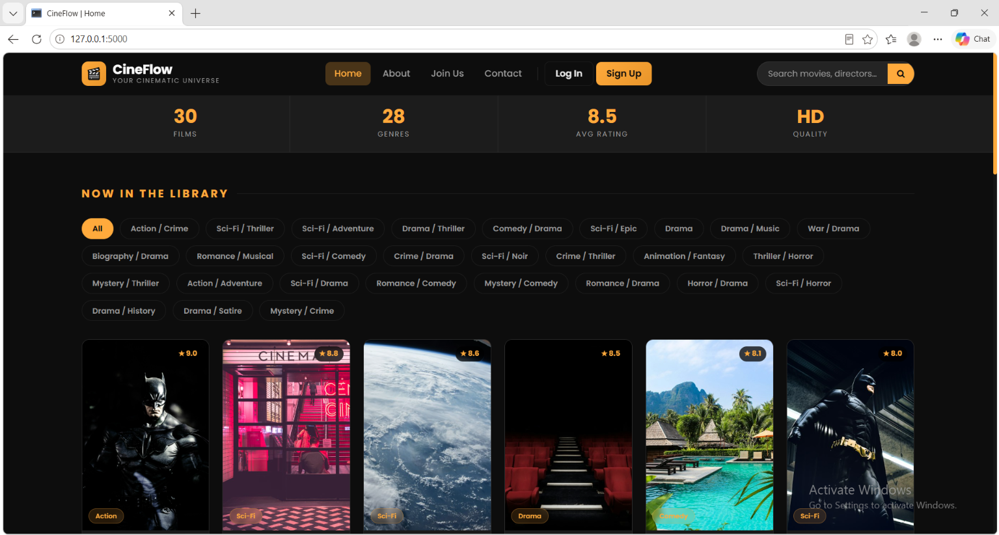

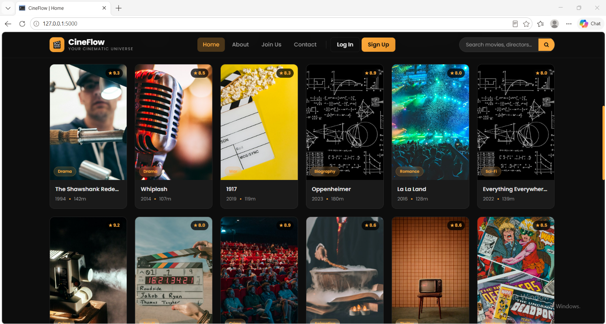

### Movie Details & Trailers

Explore individual movie pages and their related content.

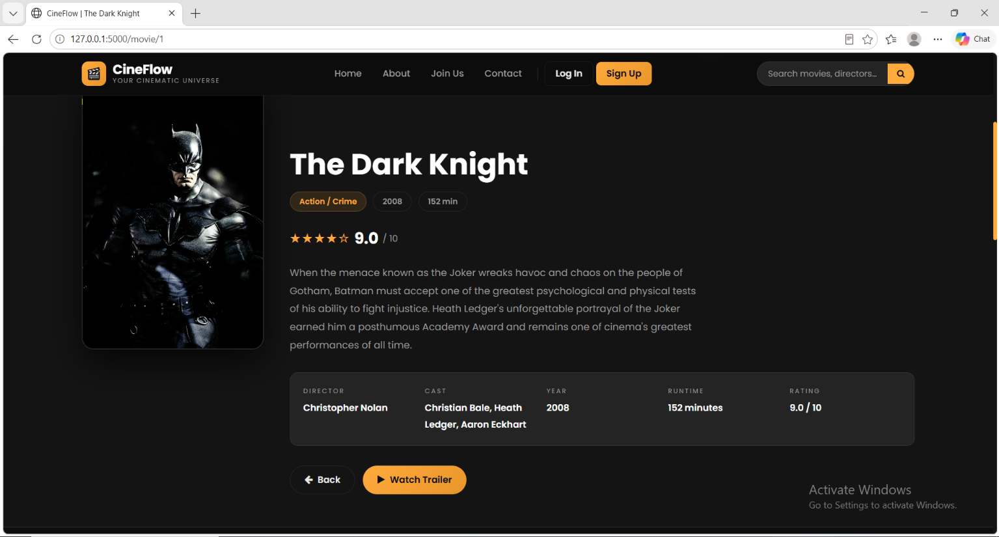

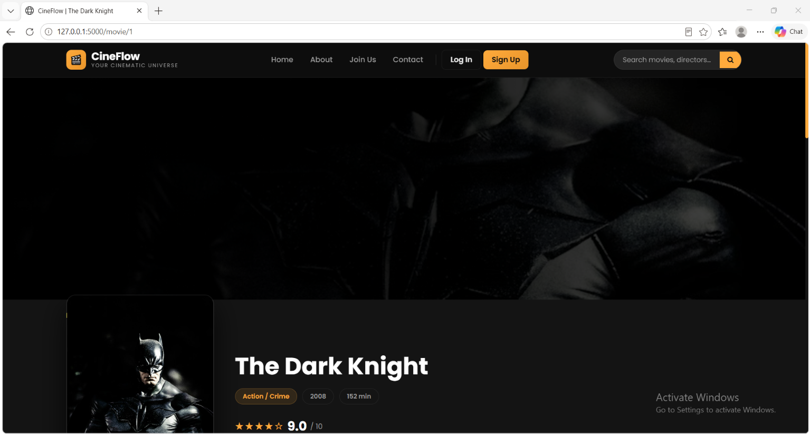

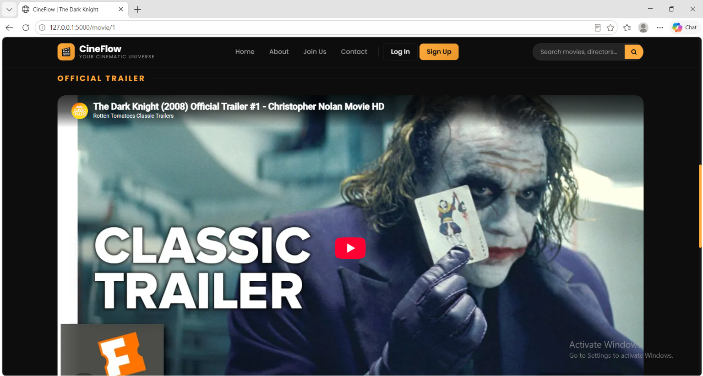

### User Interface

Login and registration pages.

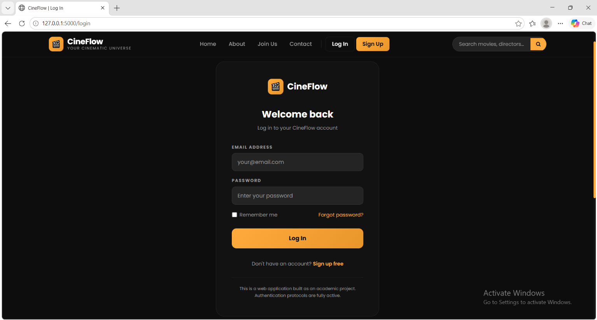

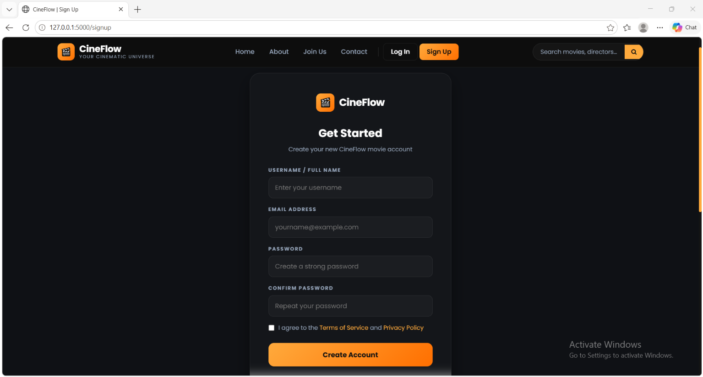

### About CineFlow

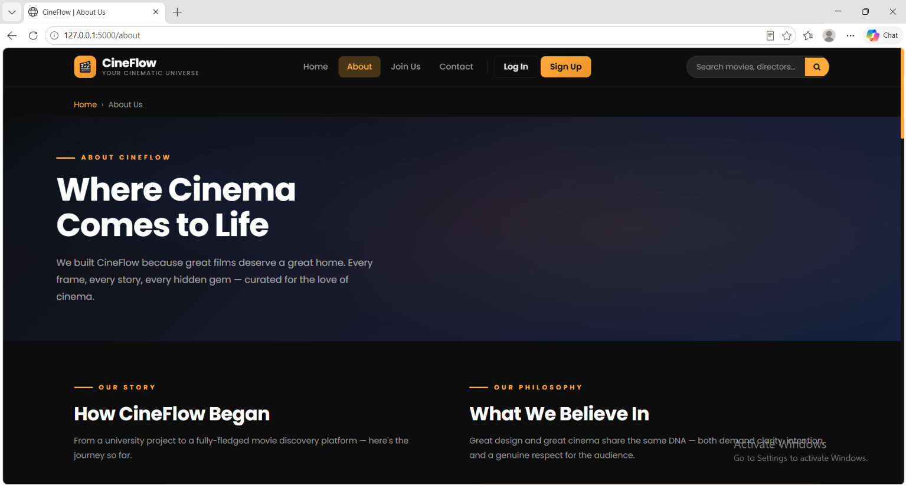

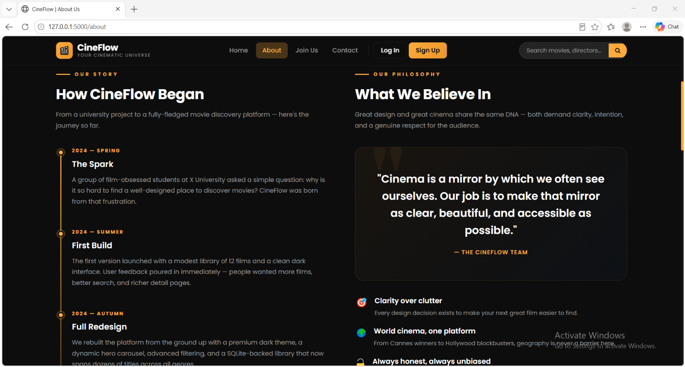

### Join Us

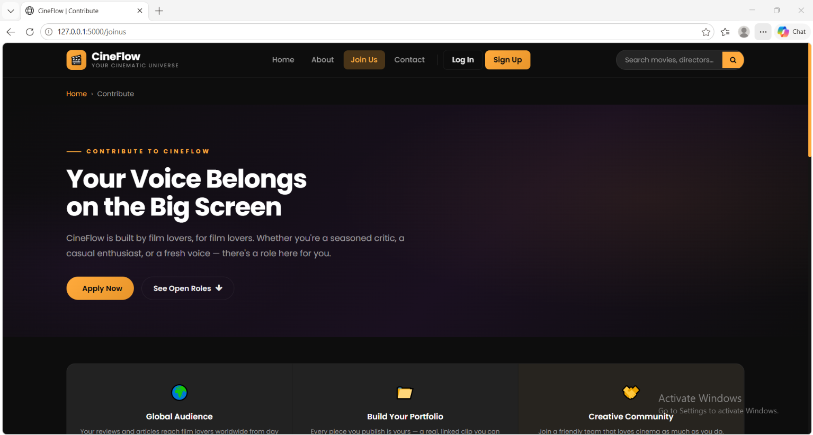

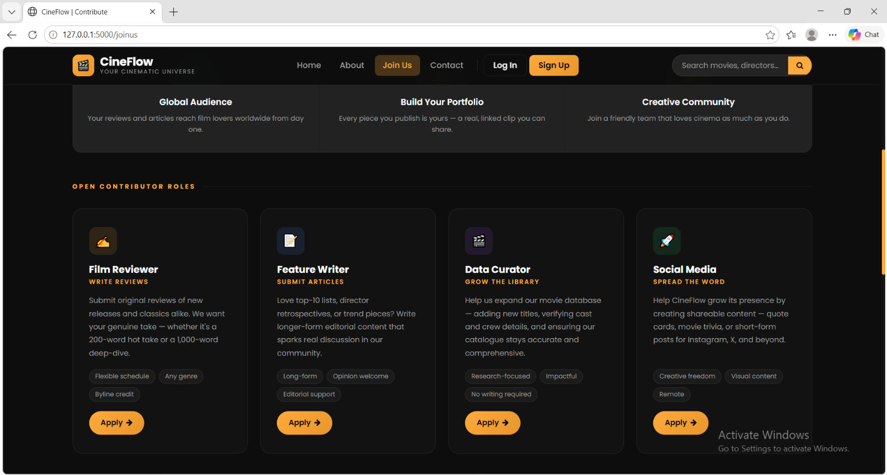

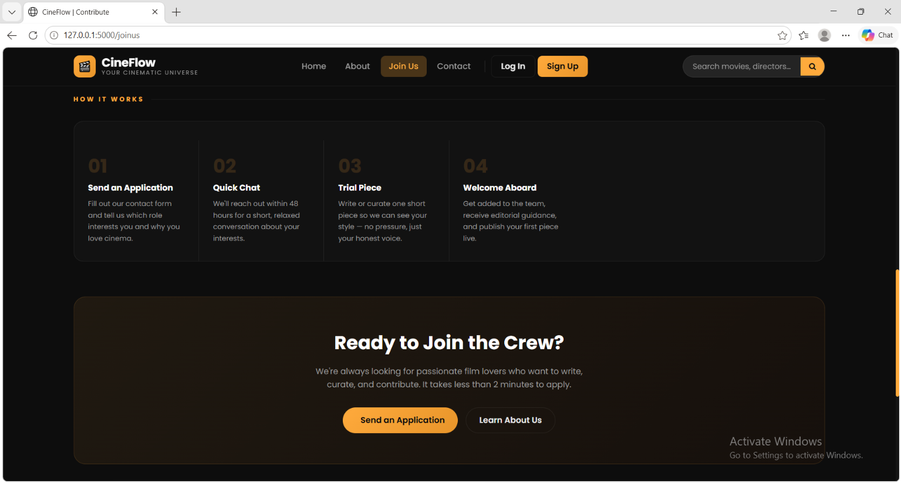

### Contact

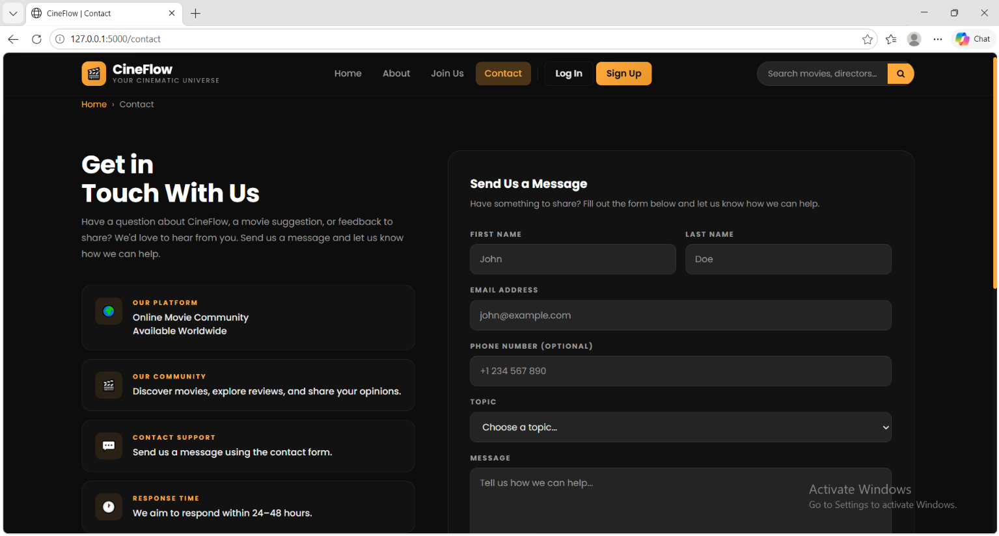

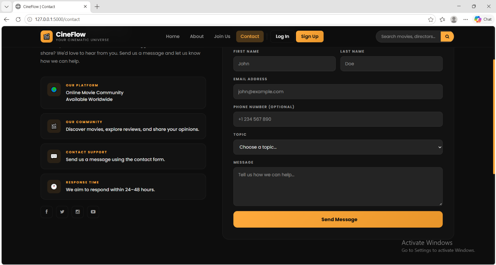

---

## Features

* Movie-focused homepage and browsing interface
* Individual movie detail pages
* Movie trailer section
* Search page
* User login and registration interfaces
* User profile page
* About and Contact pages
* Join Us page
* Organized static assets, stylesheets and templates

## Technologies Used

| Technology | Purpose                   |
| ---------- | ------------------------- |
| Python     | Backend development       |
| Flask      | Web application framework |
| HTML5      | Page structure            |
| CSS3       | Styling and layout        |
| JavaScript | Frontend interactions     |
| Jinja2     | Dynamic HTML templating   |

## Project Structure

```text
CineFlow/
│
├── app.py
├── models.py
├── Contents/
│
├── CineFlow-Screenshots/
│
├── static/
│   ├── css/
│   ├── fonts/
│   ├── images/
│   └── js/
│
├── templates/
│   ├── 404.html
│   ├── about.html
│   ├── base.html
│   ├── contact.html
│   ├── index.html
│   ├── joinus.html
│   ├── login.html
│   ├── movie_detail.html
│   ├── profile.html
│   ├── search.html
│   └── signup.html
│
└── .gitignore
```

## Getting Started

### Prerequisites

* Python 3.x
* pip
* Git

### 1. Clone the repository

```bash
git clone https://github.com/sivih/CineFlow.git
```

### 2. Navigate to the project directory

```bash
cd CineFlow
```

### 3. Create a virtual environment

```bash
python -m venv .venv
```

### 4. Activate the virtual environment

**Windows:**

```bash
.venv\Scripts\activate
```

### 5. Install dependencies

Install Flask and the additional Python packages required by the application.

### 6. Run the application

```bash
python app.py
```

Open your browser and navigate to:

```text
http://127.0.0.1:5000
```

---

## Project Purpose

CineFlow was developed as a web development project to gain practical experience with Python, Flask, frontend technologies, and the structure of web applications.

It demonstrates the application of backend and frontend concepts in building a movie-oriented website.

## Author

**Sivjena H**

GitHub: [@sivih](https://github.com/sivih)

Project Repository: [CineFlow](https://github.com/sivih/CineFlow)

---

*Discover movies. Explore stories. Share your passion.*
